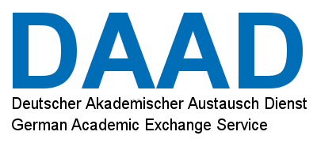
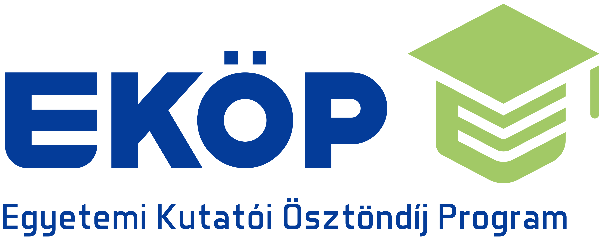
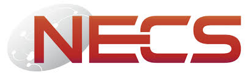
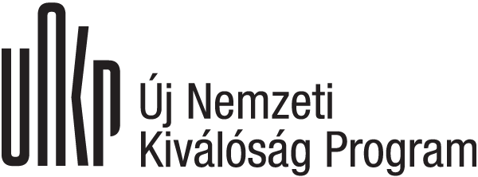
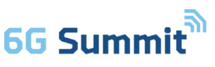

  <ol class="recognition-list">
    <li class="recognition-item">
      <time class="recognition-year" datetime="2026">2026</time>
      <article class="recognition-card">
        

          <h3 class="recognition-title">Most Inspiring 6G Use Case Award</h3>
          Award
        

        
As part of NATWORK · 6G Summit, Spain

      </article>
    </li>
    <li class="recognition-item">
      <time class="recognition-year" datetime="2024">2024</time>
      <article class="recognition-card grant">
        

          <h3 class="recognition-title">Postdoctoral Grant</h3>
          Grant
        

        
EKOP · ELTE/IDACUS · Hungary and Germany

      </article>
    </li>
    <li class="recognition-item">
      <time class="recognition-year" datetime="2023">2023</time>
      <article class="recognition-card grant">
        

          <h3 class="recognition-title">Project Proposal Grant</h3>
          Grant
        

        
NATWORK · European Union

      </article>
    </li>
    <li class="recognition-item">
      <time class="recognition-year" datetime="2022">2022</time>
      <article class="recognition-card">
        

          <h3 class="recognition-title">Best Paper Award</h3>
          Award
        

        
IEEE ICISPP · Southeast University, China

      </article>
    </li>
    <li class="recognition-item">
      <time class="recognition-year" datetime="2022">2022</time>
      <article class="recognition-card grant">
        

          <h3 class="recognition-title">Research Grant</h3>
          Grant
        

        
UNKP · ELTE University, Hungary

      </article>
    </li>
    <li class="recognition-item">
      <time class="recognition-year" datetime="2021">2021</time>
      <article class="recognition-card">
        

          <h3 class="recognition-title">Bronze Award</h3>
          Award
        

        
EIT Health Innovation Day · European Union

      </article>
    </li>
    <li class="recognition-item">
      <time class="recognition-year" datetime="2020">2020</time>
      <article class="recognition-card">
        

          <h3 class="recognition-title">Best Paper Award</h3>
          Award
        

        
IEEE ICCECE · University of Essex, UK

      </article>
    </li>
    <li class="recognition-item">
      <time class="recognition-year" datetime="2019">2019</time>
      <article class="recognition-card">
        

          <h3 class="recognition-title">Gold Award</h3>
          Award
        

        
EIT Health Innovation Day · European Union

      </article>
    </li>
    <li class="recognition-item">
      <time class="recognition-year" datetime="2018">2018</time>
      <article class="recognition-card grant">
        

          <h3 class="recognition-title">NeCS Tuition Grant</h3>
          Grant
        

        
University of Trento, Italy

      </article>
    </li>
    <li class="recognition-item">
      <time class="recognition-year" datetime="2010">2010</time>
      <article class="recognition-card grant">
        

          <h3 class="recognition-title">Research Grant</h3>
          Grant
        

        
DAAD · TU Berlin, Germany

      </article>
    </li>
    <li class="recognition-item">
      <time class="recognition-year" datetime="2008">2008</time>
      <article class="recognition-card">
        

          <h3 class="recognition-title">Minister of Higher Education Award</h3>
          Award
        

        
For holding the highest GPA

      </article>
    </li>
    <li class="recognition-item">
      <time class="recognition-year" datetime="2008">2008</time>
      <article class="recognition-card">
        

          <h3 class="recognition-title">Deputy Prime Minister Award</h3>
          Award
        

        
For holding the highest GPA

      </article>
    </li>
  </ol>

  <section class="recognition-partners" aria-labelledby="recognition-partners-title">
    <h2 class="recognition-partners-title" id="recognition-partners-title"></h2>
    

      
      
      
      
      
      
    

  </section>

  
<strong>Disclaimer:</strong> The achievements, awards, and grants listed here reflect my individual contributions and involvement in collaborative efforts. Recognition and funding may have been awarded to individuals, teams, or institutions, and their inclusion does not imply sole ownership, individual attribution, or endorsement by the awarding or funding organizations.

