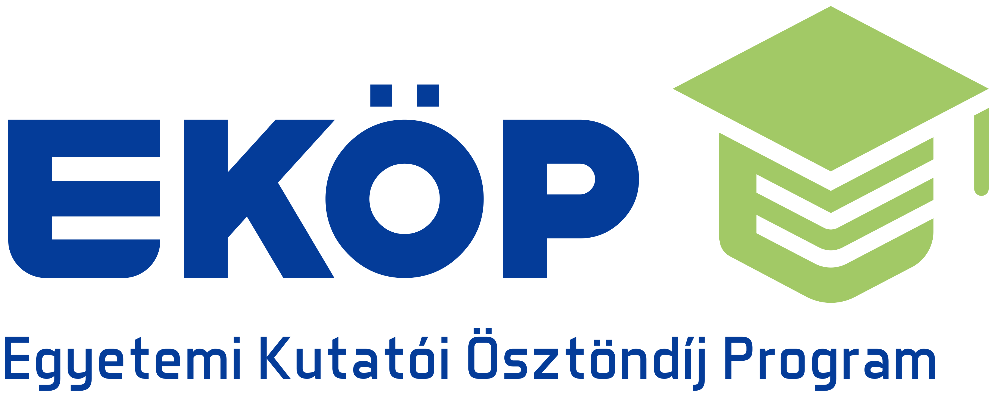
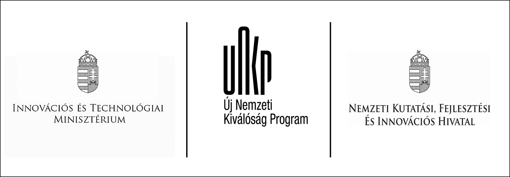
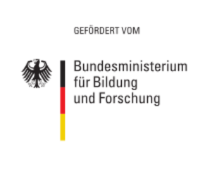
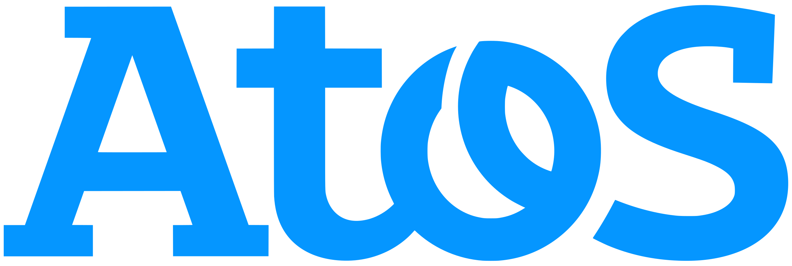

  
Selected research projects and collaborations in cybersecurity, privacy, and secure digital infrastructure.

  

    <article class="project-card">
      

        <h2 class="project-title">6G Security</h2>
        
Senior cybersecurity researcher leading the following research pillars:

        <ul class="project-details">
          <li>Pillar 1 - Trust Establishment in B5G/6G Network</li>
          <li>Pillar 2 - Secure Federated Learning in B5G/6G Network</li>
          <li>HORIZON-101139285: NATWORK</li>
        </ul>
      

      

        
      

    </article>

    <article class="project-card">
      

        <h2 class="project-title">Industrial Internet of Things Security</h2>
        <ul class="project-details">
          <li>Safeguarding Industrial Internet of Things authentication</li>
          <li>EKOP-24-4-2: Postdoctoral Research Scholarship</li>
        </ul>
      

      

        
      

    </article>

    <article class="project-card">
      

        <h2 class="project-title">Thematic Excellence Program</h2>
        <ul class="project-details">
          <li>Developing secure data validators</li>
          <li>TKP2020-NKA-06: Hungarian National Challenges - Cybersecurity Subprogramme</li>
        </ul>
      

      

        
      

    </article>

    <article class="project-card">
      

        <h2 class="project-title">Secure Navigation</h2>
        <ul class="project-details">
          <li>Developing a secure Galileo navigation authentication protocol</li>
          <li>1.3-KK: Software and Data-Intensive Services project</li>
        </ul>
      

      

        
      

    </article>

    <article class="project-card">
      

        <h2 class="project-title">Lightweight Cryptography</h2>
        <ul class="project-details">
          <li>Developing lightweight attribute-based encryption for smart IoT devices</li>
          <li>ÚNKP-22-4: Research Scholarship for Doctoral Candidates</li>
        </ul>
      

      

        
      

    </article>

    <article class="project-card">
      

        <h2 class="project-title">Distributed Security</h2>
        <ul class="project-details">
          <li>Developing secure protocols for distributed environments</li>
          <li>ÚNKP-21-3: Research Scholarship for Doctoral Students</li>
        </ul>
      

      

        
      

    </article>

    <article class="project-card">
      

        <h2 class="project-title">Autonomous Vehicle Control</h2>
        <ul class="project-details">
          <li>Developing lightweight cryptographic protocols</li>
          <li>VEKOP-16: Talent Management in Autonomous Vehicle Control</li>
        </ul>
      

      

        
      

    </article>

    <article class="project-card">
      

        <h2 class="project-title">Smart Platform for Digital Networks</h2>
        <ul class="project-details">
          <li>Developing secure SDN for cyber-physical systems</li>
          <li>02P17D022: Collaborative smart contracting platform for digital value creation networks</li>
        </ul>
      

      

        
      

    </article>

    <article class="project-card">
      

        <h2 class="project-title">Secure Cryptographic Protocols</h2>
        <ul class="project-details">
          <li>Developing secure cryptographic protocols</li>
          <li>EFOP-3.6.2: Innovations in Informatics and Infocommunication</li>
        </ul>
      

      

        
      

    </article>

    <article class="project-card">
      

        <h2 class="project-title">Orchestration of Financial Services</h2>
        <ul class="project-details">
          <li>Blockchain analyzer</li>
          <li>OFION: Communication and Security Analysis of the Cloud Orchestrator Module</li>
        </ul>
      

      

        
      

    </article>
  

<strong>Disclaimer:</strong> The projects listed here reflect my involvement and contributions, independently or as part of collaborative efforts. Project descriptions are provided for informational purposes and do not imply sole ownership, authorship, or endorsement by affiliated institutions, collaborators, or sponsors.

