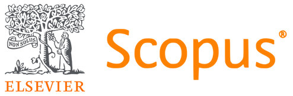
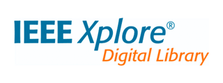
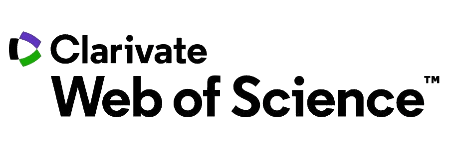




## Online Repositories

 

  

 

  
 

 

 

---
## Selected Publications

  

  
    <article class="pub-card">
      

        <h3 class="pub-title">{{ pub.title }}</h3>
      

      

        
          
            <strong>{{ author }}</strong>
          
            {{ author }}
          
          , 
        
      

      
{{ pub.venue }}

      

        {{ pub.year }}
        Q1
        Q2
        Q3
        Q4
        Tier A
        Tier B
        Award winner
        Open access
        <a href="{{ pub.links.doi }}" target="_blank" rel="noopener noreferrer">DOI</a>
        <a href="{{ pub.links.pdf }}">PDF</a>
        <a href="{{ pub.links.code }}">Code</a>
        <a href="{{ pub.links.project }}">Project</a>
        <a href="{{ pub.links.slides }}">Slides</a>
        <a href="{{ pub.links.talk }}">Talk</a>
        <a href="{{ pub.links.bibtex }}">BibTeX</a>
        <a href="{{ pub.links.arxiv }}">arXiv</a>
      

      
        
{{ pub.summary }}

      
    </article>
  
  

---

### Services
- <a href="https://globecom2025.ieee-globecom.org/" target="_blank">IEEE Globecom 2025</a>
- <a href="https://ficloud.org/2025/" target="_blank">IEEE FiCloud 2025</a>
- <a href="https://globecom2024.ieee-globecom.org/" target="_blank">IEEE Globecom 2024</a>
- <a href="http://www.wimob.org/wimob2023/" target="_blank">IEEE Wimob 2023</a>
- <a href="https://www.atis2021.conferences.academy/" target="_blank">ATIS 2021</a>
- [CIoT 2019]()
- <a href="https://onlinelibrary.wiley.com/journal/24756725" target="_blank">Security and Privacy</a>
- <a href="https://www.sciencedirect.com/journal/computer-networks" target="_blank">Computer Networks</a>
- <a href="https://www.sciencedirect.com/journal/future-generation-computer-systems" target="_blank">Future Generation Computer Systems</a>
- <a href="https://www.mdpi.com/journal/jcp" target="_blank">Journal of Cybersecurity and Privacy</a>
- <a href="https://www.pearson.com/en-us/subject-catalog/p/information-privacy-engineering-and-privacy-by-design/P200000007406/9780137582341" target="_blank">Information Privacy Engineering and Privacy by Design</a>